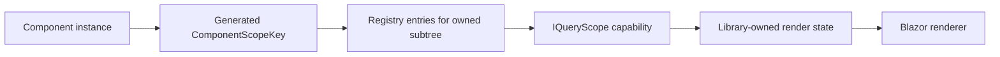

# Component Scoping Boundaries

## Decision

Reusable components will use logical query capabilities, not nested dependency-injection lifetimes. Creating an `IServiceScope` for every component would add allocation and disposal overhead, fragment the shared ownership registry, and make intentional page/layout orchestration needlessly difficult.

Component isolation is therefore an API and registry constraint. It is not a security boundary against code that deliberately resolves an unrestricted page or layout query service.

## Current state

Component-instance query scoping is **not implemented**. The current `QueryElementRegistry` records stable element keys and `ParentElementKey` relationships only. It does not record a component-instance key, hold a `ComponentBase` reference, or support `this.Query(...)` / `$(selector, context)` semantics.

## Planned model

The generator and component wrappers will establish a generated/cascaded `ComponentScopeKey` for every reusable control instance. Each owned descendant will register its element key, parent element key, selectors, and component scope key.



The consumer-facing shape is capability-based:

```csharp
public interface IQueryScope
{
    QuerySelection Select(string selector);
}

public interface IQueryScopeFactory
{
    IQueryScope CreateComponentScope(string scopeKey);
}
```

A control receives an `IQueryScope` created for its own generated scope key. `Select` resolves only registry entries carrying that key, so normal component code cannot traverse outward into sibling, page, layout, or application entries.

```csharp
[Inject] private IQueryScopeFactory QueryScopes { get; set; } = default!;

private IQueryScope queryScope = default!;

protected override void OnInitialized() =>
    queryScope = QueryScopes.CreateComponentScope(ComponentScopeKey);

// queryScope.Select(".accordion-body")
```

Page and layout orchestration remain explicit through the existing `Query` and `LayoutQuery` APIs. No public `ElementReference`, component reference, or arbitrary DOM context is required.

## Required registry and lifecycle changes

- Add `ComponentScopeKey` to each `QueryElementRegistry` entry.
- Add scope-constrained selection and subtree traversal operations.
- Register `QueryScopeRegistry` and `IQueryScopeFactory` with the existing application/service scope; do not create an `IServiceScope` per component.
- On `QueryElement.Dispose`, unregister the stable key and remove it from its component scope.
- On component-scope disposal, invalidate only that scope’s keys and owned state; page/layout/application lifetimes remain unchanged.
- Test repeated component instances, nested scopes, attempted outward traversal, rerendering, and disposal.

## Delivery boundary

This belongs to Sprint 3 / Feature 4468, alongside class and structural state operations. It is a prerequisite for presenting reusable accordion, tab, and dropdown examples as component-scoped orchestration.
