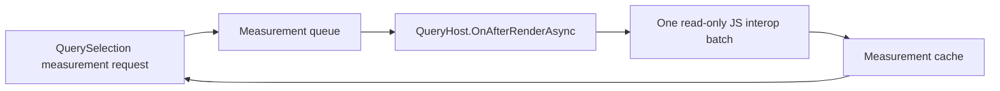

# Measurement and Position Boundary

## Decision

Dimensions and positions are browser-computed observations. They cannot be derived from Blazor render state before the browser completes layout. Reflections.Blazor.Query will expose them through a read-only JavaScript interop adapter while preserving the library-owned rendering model.

JavaScript is an observation adapter, never a second renderer. It must not set attributes, properties, classes, styles, content, structure, or event handlers on Blazor-owned nodes.

The implementation uses an isolated custom JS module and generated `data-rbq-key` values. It does not expose or track `ElementReference`, DOM nodes, or `IJSObjectReference` as part of the public query API. This keeps selection semantics stable across Server, WebAssembly, and Auto while enforcing ownership at the interop boundary.

## API contract

The following APIs are asynchronous measurement reads:

- `HeightAsync`, `WidthAsync` (**implemented**)
- `InnerHeightAsync`, `InnerWidthAsync` (**implemented**)
- `OuterHeightAsync`, `OuterWidthAsync` (**implemented; margins excluded**)
- `OffsetAsync`, `OffsetParentAsync`, `PositionAsync` (**implemented**)

The implementation names use `Async` suffixes to make the browser boundary visible to consumers. The implemented APIs return the first resolved owned element's nullable CSS-pixel snapshot; empty or unavailable selections return `null`. `HeightAsync` / `WidthAsync` and outer dimensions use the border box. Inner dimensions exclude border widths. They do not return browser handles.

`Height(double)` and `Width(double)` are implemented as separate render-state write operations. They accept finite non-negative CSS pixel values, emit generated-key CSS rules for each resolved owned element, and never call JavaScript.

## Data flow

1. A selection enqueues one or more keyed measurement requests and returns an awaitable result.
2. Requests are keyed by generated `data-rbq-key`, measurement kind, and options.
3. During a render cycle, identical requests are coalesced; callers await the same pending result.
4. `QueryHost.OnAfterRenderAsync` flushes the queue after Blazor has rendered.
5. One JS module invocation reads all requested values using browser layout APIs and returns serializable DTOs.
6. The measurement service completes callers and records the result in its snapshot cache.

The initial implementation supports dimensions plus typed offset, position, and owned offset-parent snapshots. It uses `getBoundingClientRect()` plus computed border widths and is covered by fake-bridge and bUnit host-flush tests. Margin-inclusive outer dimensions remain deliberately deferred.

The cache is read-only from the rendering pipeline. Completing a measurement does not call `StateHasChanged`; any consumer that needs to render a result decides explicitly when to do so.

## Browser semantics

| API | Browser source | Contract |
| --- | --- | --- |
| Height/Width | `getBoundingClientRect()` | Border-box CSS pixels from the post-render layout snapshot. |
| InnerHeight/InnerWidth | layout size minus borders | Defined from computed layout values and returned as CSS pixels. |
| OuterHeight/OuterWidth | `getBoundingClientRect()` | Border-box size; margin inclusion, if supported, is an explicit option. |
| OffsetAsync | rect plus `scrollX` / `scrollY` | Document-relative border-box origin in CSS pixels, returned as `QueryPoint`. |
| PositionAsync | rect relative to DOM `offsetParent` | Border-box origin relative to the offset parent's padding box, adjusted for its scroll offset; returns `null` when there is no DOM offset parent. |
| OffsetParentAsync | read-only DOM `offsetParent` resolution | Returns the stable key only when that parent carries a library-owned `data-rbq-key`; otherwise returns `null`. |

No API returns an arbitrary `ElementReference`, DOM node, or JavaScript object reference as a public result.

## Batching and lifecycle

`BeginBatch()` continues to batch render-state writes. Measurement batching is asynchronous and coordinated with the host render lifecycle rather than piggybacking on synchronous state flushing.

- Multiple reads issued before the next post-render flush use one JS invocation.
- A host flush never reads before its owning scope has rendered.
- Navigation and `QueryHost` disposal cancel pending requests and invalidate page-scoped snapshots.
- Layout and application caches follow their respective scope lifetimes.
- Future `ResizeObserver` support may invalidate snapshots; it must remain read-only and be disposed with the owning host.

### Disposal lifecycle rules

| Trigger | Pending requests | Measurement cache | Required cleanup |
| --- | --- | --- | --- |
| Page navigation | Cancel page-scoped requests. | Invalidate page-scoped snapshots. | Clear page render state through the existing host navigation policy. |
| Same layout survives navigation | Keep layout-scoped requests and snapshots. | Retain while the layout instance is mounted. | Do not clear layout state merely because page content changed. |
| Application lifetime | Keep application-scoped work until explicit application disposal. | Retain for the configured application scope. | Dispose only on explicit application shutdown/disposal. |
| `QueryElement.Dispose` | Complete requests for that key as cancelled or unavailable. | Invalidate that element key. | Unregister the key from `QueryElementRegistry`. |
| `QueryHost.Dispose` | Cancel all queue work owned by that host. | Invalidate the host scope cache. | Unsubscribe navigation and render callbacks; dispose observer/module resources; reject late completions. |

Late JavaScript results must be ignored after their request or host has been cancelled or disposed. Completion of a valid measurement updates only the measurement cache; it never calls `StateHasChanged` implicitly.

## Security and performance constraints

- The JS module accepts only library-generated element keys and requested measurement kinds.
- It resolves only `[data-rbq-key]` elements owned by the library.
- It performs all reads in a batch and performs no writes, avoiding read/write layout-thrashing cycles.
- Missing, disposed, or non-owned elements produce typed unavailable results rather than browser exceptions.
- The JS module resolves only an exact library-owned key and must not accept arbitrary selectors or public element references.
- Server, WebAssembly, and Auto must share the same DTO and batching contract.

## Acceptance criteria

- One queued batch produces one JS interop invocation after render.
- Duplicate requests coalesce.
- Measurement reads cause no DOM mutation and no implicit rerender.
- Page navigation and host disposal cancel or invalidate outstanding work deterministically.
- `QueryElement` disposal invalidates its key and prevents late measurement completion from repopulating the cache.
- `QueryHost` disposal unsubscribes callbacks and disposes every host-owned observer/module resource.
- Results are correct for zero, one, and multiple owned elements.
- Browser-level coverage passes in Interactive Server, WebAssembly, and Auto.
- `Offset`, `Position`, and `OffsetParent` semantics are documented and tested before being advertised as jQuery-compatible.

## Manual browser validation

The initial live validation was performed against local Interactive Server, Interactive WebAssembly, and Interactive Auto demo hosts. Each host rendered a `QueryElement`, invoked the queued `WidthAsync` path through a Blazor event, displayed a browser-calculated result, and produced no console warnings or errors. All three hosts also exercised `OffsetAsync`, `PositionAsync`, and the external-parent `OffsetParentAsync` unavailable result; the Server demo additionally exercised `HeightAsync`.

This is implementation evidence, not a replacement for automated browser coverage. The remaining browser suite must cover every metric plus navigation, disposal, cancellation, and late-result behavior.
