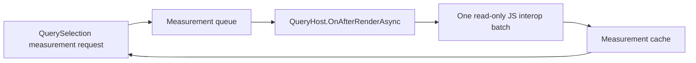

# Measurement and Position Boundary

## Decision

Dimensions and positions are browser-computed observations. They cannot be derived from Blazor render state before the browser completes layout. Reflections.Blazor.Query will expose them through a read-only JavaScript interop adapter while preserving the library-owned rendering model.

JavaScript is an observation adapter, never a second renderer. It must not set attributes, properties, classes, styles, content, structure, or event handlers on Blazor-owned nodes.

## API contract

The following APIs are asynchronous measurement reads:

- `Height_Get`, `Width_Get`
- `InnerHeight`, `InnerWidth`
- `OuterHeight`, `OuterWidth`
- `Offset`, `OffsetParent`, `Position`

The implementation names will use `Async` suffixes (for example, `HeightAsync`) to make the browser boundary visible to consumers. They return immutable DTOs, not browser handles.

`Height_Set` and `Width_Set` are separate render-state write operations. They emit library-owned CSS state and must not call JavaScript.

## Data flow

1. A selection enqueues one or more keyed measurement requests and returns an awaitable result.
2. Requests are keyed by generated `data-rbq-key`, measurement kind, and options.
3. During a render cycle, identical requests are coalesced; callers await the same pending result.
4. `QueryHost.OnAfterRenderAsync` flushes the queue after Blazor has rendered.
5. One JS module invocation reads all requested values using browser layout APIs and returns serializable DTOs.
6. The measurement service completes callers and records the result in its snapshot cache.

The cache is read-only from the rendering pipeline. Completing a measurement does not call `StateHasChanged`; any consumer that needs to render a result decides explicitly when to do so.

## Browser semantics

| API | Browser source | Contract |
| --- | --- | --- |
| Height/Width | `getBoundingClientRect()` | Border-box CSS pixels from the post-render layout snapshot. |
| InnerHeight/InnerWidth | layout size minus borders | Defined from computed layout values and returned as CSS pixels. |
| OuterHeight/OuterWidth | `getBoundingClientRect()` | Border-box size; margin inclusion, if supported, is an explicit option. |
| Offset | rect plus `scrollX` / `scrollY` | Document-relative CSS-pixel coordinates. |
| Position | rect relative to resolved offset parent | Requires a separately tested offset-parent algorithm. |
| OffsetParent | read-only ancestor resolution | Returns an owned-element key when the ancestor is library-owned; otherwise returns an explicit external/unavailable result. |

No API returns an arbitrary `ElementReference`, DOM node, or JavaScript object reference as a public result.

## Batching and lifecycle

`BeginBatch()` continues to batch render-state writes. Measurement batching is asynchronous and coordinated with the host render lifecycle rather than piggybacking on synchronous state flushing.

- Multiple reads issued before the next post-render flush use one JS invocation.
- A host flush never reads before its owning scope has rendered.
- Navigation and `QueryHost` disposal cancel pending requests and invalidate page-scoped snapshots.
- Layout and application caches follow their respective scope lifetimes.
- Future `ResizeObserver` support may invalidate snapshots; it must remain read-only and be disposed with the owning host.

## Security and performance constraints

- The JS module accepts only library-generated element keys and requested measurement kinds.
- It resolves only `[data-rbq-key]` elements owned by the library.
- It performs all reads in a batch and performs no writes, avoiding read/write layout-thrashing cycles.
- Missing, disposed, or non-owned elements produce typed unavailable results rather than browser exceptions.
- Server, WebAssembly, and Auto must share the same DTO and batching contract.

## Acceptance criteria

- One queued batch produces one JS interop invocation after render.
- Duplicate requests coalesce.
- Measurement reads cause no DOM mutation and no implicit rerender.
- Page navigation and host disposal cancel or invalidate outstanding work deterministically.
- Results are correct for zero, one, and multiple owned elements.
- Browser-level coverage passes in Interactive Server, WebAssembly, and Auto.
- `Offset`, `Position`, and `OffsetParent` semantics are documented and tested before being advertised as jQuery-compatible.
